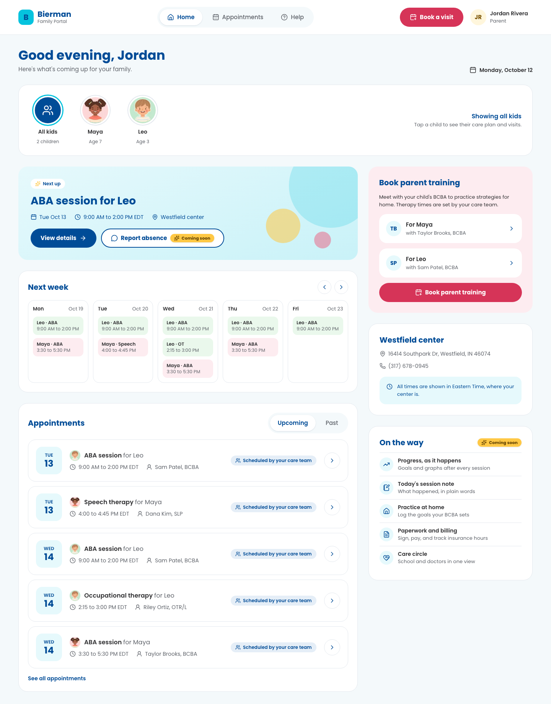
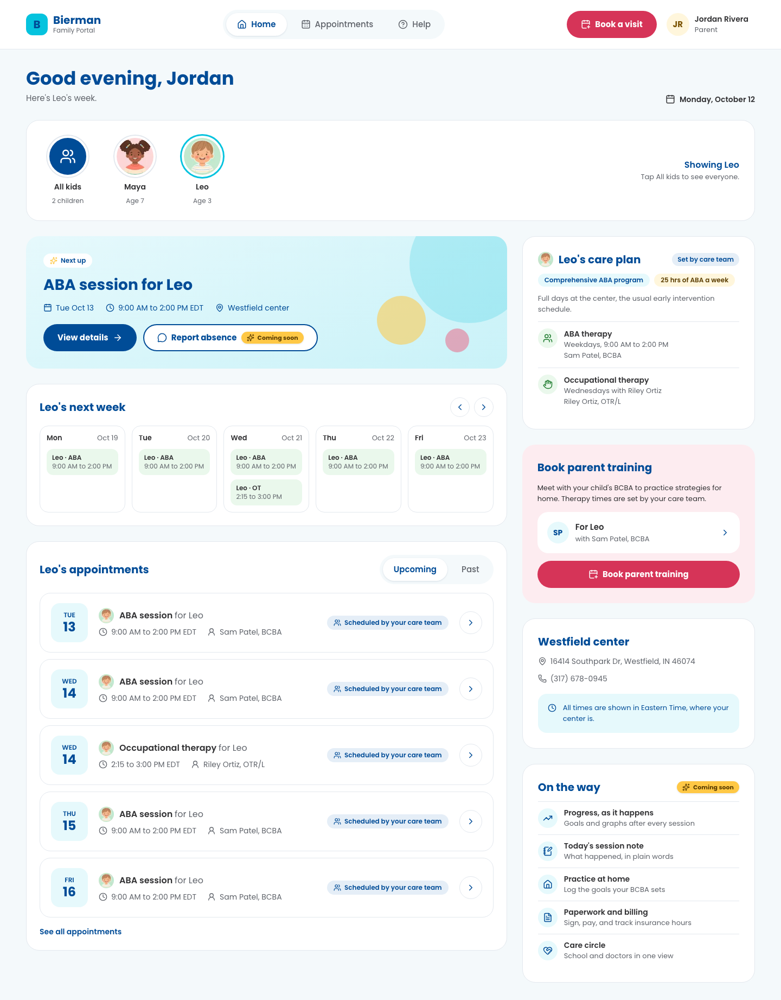
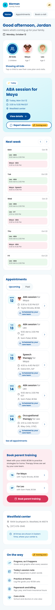
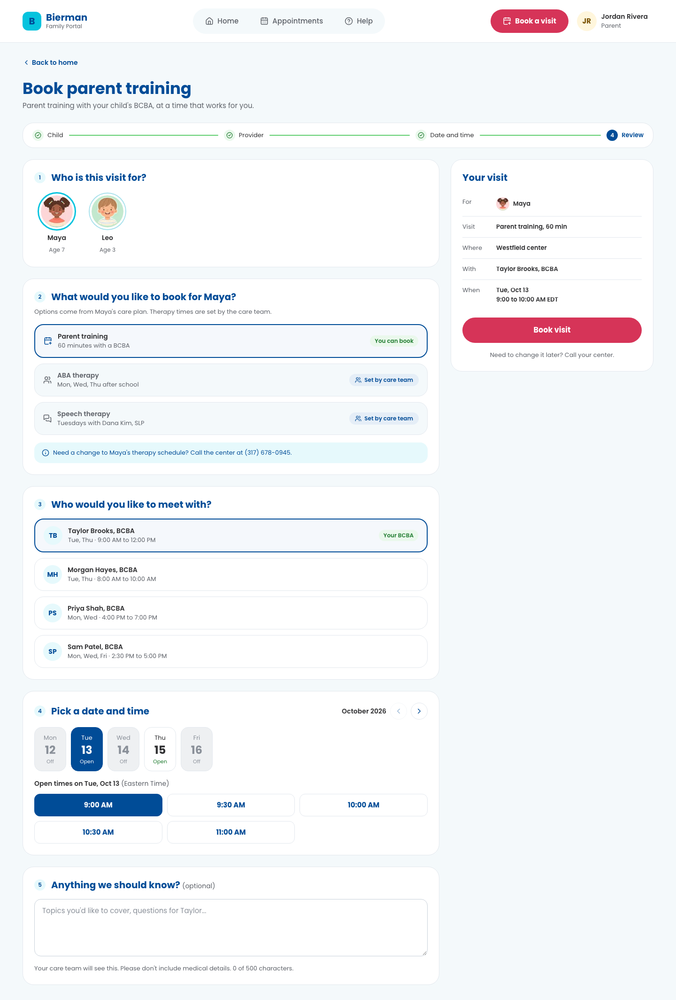
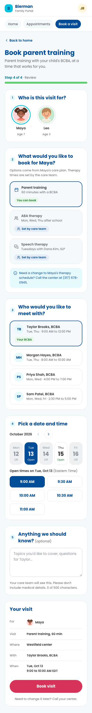
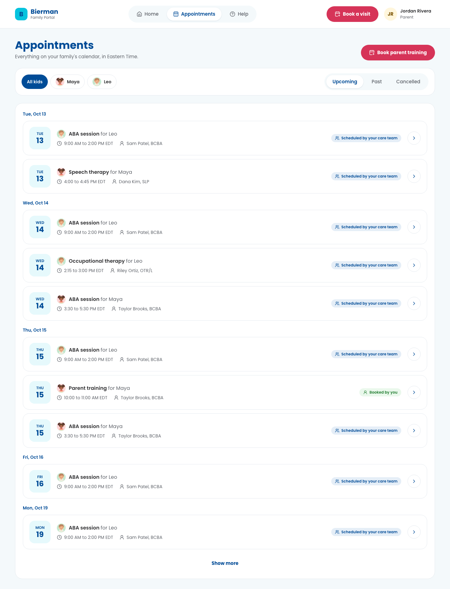
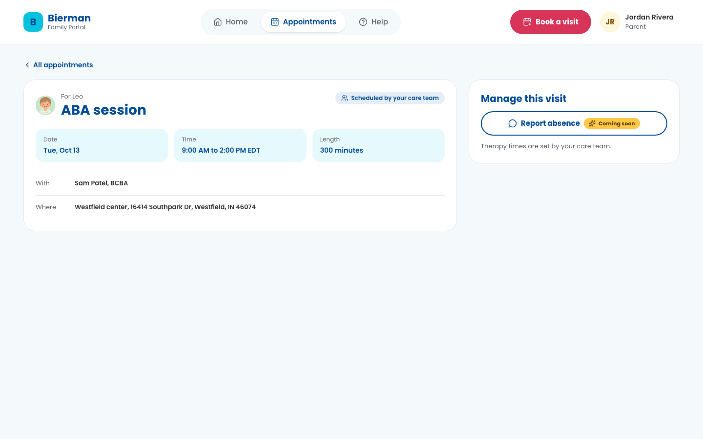
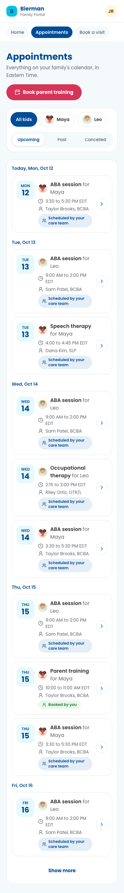
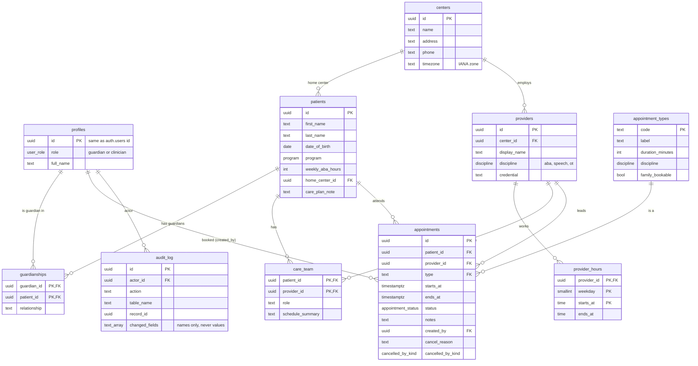

# Bierman Family Portal

[](https://github.com/brookelkennison/bierman-family-portal/actions/workflows/ci.yml)

A secure appointment portal for families at Bierman Autism Centers. Parents see
their children's therapy schedule and care plans, and book parent training
with their child's BCBA. Built with Next.js, TypeScript, Tailwind, and
Supabase (Postgres and Auth).

**Live:** https://bierman-family-portal.vercel.app/ · **Fake data only.** Every name, child, and visit is made up.



## Demo logins

| Email                | Who                               | What you'll see                      |
| -------------------- | --------------------------------- | ------------------------------------ |
| `jordan@example.com` | Parent of Maya (7) and Leo (3)    | Full dashboard, booking, care plans  |
| `casey@example.com`  | Parent of Ava, a different family | Proves families can't see each other |
| `jamie@example.com`  | No children linked yet            | The empty state                      |

Password for all three: `Bierman1!`

## Scope

Per the team's guidance (Oct 11), this covers **create and read**:

- **Create:** book parent training with a BCBA, with live open times.
- **Read:** dashboard, week view, care plans, appointment list with filters, and appointment detail.
- **Update and delete** (reschedule, cancel, report absence, delete) stay in the UI
  where the designs put them, with a **Coming soon** badge. Clicking explains how to
  make the change by phone. No update or delete request is ever sent.

## Product assumptions

- **Parents log in, clinicians don't (yet).** A parent can have several children, and a child can have several guardians.
- **The center creates accounts and links children.** There is no public sign-up. Letting parents add children would let anyone claim any child. ([ADR 008](docs/adr/008-accounts-and-children-provisioned.md))
- **Only parent training is family-bookable.** ABA, speech, and OT follow a weekly schedule set by the care team and tied to insurance-authorized hours. Parents see those, but can't book or move them. ([ADR 009](docs/adr/009-parent-training-only-family-bookable.md))
- **Each BCBA has their own hours** for parent training, and parents pick from BCBAs at their child's home center. ([ADR 010](docs/adr/010-provider-hours.md))
- **Times are stored in UTC and always shown in the center's time zone**, with the zone (EDT or EST), never the browser's. ([ADR 004](docs/adr/004-utc-storage-center-timezones.md))
- Visits start on the hour or half hour, at most 60 days out.

## Design

I designed every screen in [Figma](https://www.figma.com/design/Xnyq8R0Y9v9PYiz0IMo8Rv) before writing code, then built against it. [docs/design-qa.md](docs/design-qa.md) compares each frame to the build and lists where I changed course on purpose.

The person I designed for is a parent checking in between work and pickup. They come here to do three things: see what's next, check a visit, and book parent training. Every layout choice below comes back to keeping that path short.

### No sidebar

Most portals put navigation in a left sidebar. I left it out. A sidebar is built for apps with many sections that people live in all day. This app has three places to go (Home, Appointments, Help) and one action that matters most (Book a visit). A sidebar would add a column of chrome for three links and squeeze the week view and the appointment list into less space.

So navigation is a single top bar: logo, the three links, a pink **Book a visit** button, and the parent's menu (name, help, sign out). The booking button sits in the same spot on every page, so a parent never has to hunt for it. On mobile, the same top bar sits above a row of tab pills. I skipped a phone-style bottom tab bar because this is a responsive web app, not a native one, and a fake native bar fights the browser's own controls.

The one place a side column shows up is booking, and it's a summary, not navigation (see below).

### Home: what's next, first



- **Kid bubbles** at the top filter the whole page by child. Headings change with the filter ("Leo's next week," "Leo's appointments") and "Showing Leo" says out loud which view you're in. Parents with more than one child usually think about one kid at a time.
- **The Today or Next up card** answers the first question a parent has, with the time, the center, and the time zone right there.
- **Next week** is a strip, not a full calendar. Therapy runs on a standing weekly schedule, so a week is the unit parents plan around.
- **The care plan card** shows what the care team set and labels it "Set by care team," so it's clear what a parent can and can't change before they ever try.
- **Book parent training** sits in the right column with each child's BCBA already named.

<details>
<summary>Home on mobile</summary>



</details>

### Booking: one page with a live summary



The Figma flow started as one step per screen on mobile. I built it as one scrolling page with numbered sections instead, and a stepper at the top that fills in as you go. Every answer stays visible, so changing the child or the BCBA doesn't mean backing through screens.

- **"Your visit"** on desktop is a sticky summary that updates as you choose. It's read-only on purpose. It's there to confirm, not to edit.
- **Therapy types are listed but locked.** ABA, speech, and OT show "Set by care team" with a note to call the center, so parents learn why they can't book them instead of wondering where they went.
- **Days say Open, Off, or Full in words**, not just color, and the child's own BCBA is marked "Your BCBA."
- There's no "Where" step. Each child has one home center, so it's shown in the summary instead of asked.

<details>
<summary>Booking on mobile</summary>



</details>

### Appointments: one list, clear ownership



The list groups visits by day, and filters by child and by Upcoming, Past, or Cancelled. Every visit carries a badge that says who owns it: **Scheduled by your care team** or **Booked by you**. That one label tells a parent what they're allowed to change, using text and an icon, never color alone.

<details>
<summary>Appointment detail and mobile</summary>





</details>

### Coming soon, shown honestly

Reschedule, cancel, report absence, and delete are out of scope, but I kept them where the design puts them. The buttons stay full color with a **Coming soon** badge, and clicking one explains how to make the change by phone. Reviewers can see the whole design, and a parent is never told something happened when it didn't. The **On the way** card does the same for future features like session notes and progress.

### Smaller choices

- Times always show in the center's time zone with the zone written out ("Eastern Time"), never the browser's.
- Copy uses the child's name instead of pronouns, and never promises something the app doesn't do.
- Illustrated child avatars instead of initials, so siblings are easy to tell apart at a glance.
- Built to WCAG 2.2 AA: works at 320px and 200% zoom, full keyboard support, focus never hides under the sticky header. Details in [docs/accessibility.md](docs/accessibility.md).

## Run it locally

**You don't need to run it locally to review it.** The [live site](https://bierman-family-portal.vercel.app/) has demo data, and the logins above work there. These steps are for anyone who wants to run the code against their own Supabase project.

You need Node 22+, pnpm, and a free [Supabase](https://supabase.com) project.

1. **Clone and install**
   ```bash
   git clone https://github.com/brookelkennison/bierman-family-portal.git
   cd bierman-family-portal
   pnpm install
   ```
2. **Point the app at your Supabase project.** Copy `.env.example` to `.env.local` and fill in the project URL and publishable key (Supabase dashboard, Connect button).
3. **Create the database.** Link the project and push the migrations:
   ```bash
   pnpm supabase login
   pnpm supabase link --project-ref <your-project-ref>
   pnpm db:push
   ```
4. **Turn off public sign-ups** in Supabase: Authentication, Sign In / Providers, "Allow new users to sign up" off. Accounts come from the seed script.
5. **Seed demo data.** Copy `.env.seed.example` to `.env.seed`, add your project's secret key and a demo password, then:
   ```bash
   pnpm seed
   ```
   The secret key bypasses RLS, so it lives only in `.env.seed` (gitignored) and is used only by the seed script. Never in `.env.local`, Vercel, or the app.
6. **Start it**
   ```bash
   pnpm dev
   ```
   Open http://localhost:3000 and log in with a demo account and the `DEMO_PASSWORD` you set in `.env.seed`.

Running `pnpm seed` again resets the demo data.

## Database schema



| Table               | What it holds                                                                                                                                                     |
| ------------------- | ----------------------------------------------------------------------------------------------------------------------------------------------------------------- |
| `profiles`          | One row per login, created by a trigger. Role is always `guardian`; parents can only change their own name.                                                       |
| `patients`          | Children. Program and weekly ABA hours feed the care plan card. Seeded by the center, never by parents.                                                           |
| `guardianships`     | Which parent can see which child. Co-parents each get a row. Everything else is scoped through this table.                                                        |
| `centers`           | Address, phone, and IANA time zone. All times display in the center's zone.                                                                                       |
| `providers`         | BCBAs and therapists, each at one center.                                                                                                                         |
| `provider_hours`    | Each BCBA's weekly parent training hours, in center time. Drives the time picker and the server check.                                                            |
| `care_team`         | A child's own BCBA and therapists. Powers the care plan card and the "Your BCBA" tag.                                                                             |
| `appointment_types` | ABA session, speech, OT, parent training. Only parent training is `family_bookable`.                                                                              |
| `appointments`      | Every visit. No `center_id`: the center comes from the provider, so the two can never disagree. Cancelled visits keep their row with a reason, by whom, and when. |
| `audit_log`         | Append-only record of every appointment write: who, what, and which **field names** changed. Never the values, so notes and other PHI stay out.                   |

Constraints worth knowing about:

- **No double booking**, enforced by the database: exclusion constraints (`btree_gist`) stop overlapping visits for the same provider or the same child.
- `ends_at > starts_at`, length caps on every text field, and enums for status, role, and discipline.
- **No cascading deletes on medical records.** Foreign keys use `restrict` or `set null`.

## Security and RLS

The rule: **the database decides who sees what and what's allowed, so a bug in the app can't leak or corrupt data.** Full threat model in [docs/security.md](docs/security.md).

**Least privilege.** Logged-out users (`anon`) get nothing. Logged-in parents get read access to their own family's rows and reference data (centers, providers, hours, types), and that's all.

**`my_patient_ids()`.** One `security definer` helper returns the children the current user is a guardian of. Every child-scoped policy (`patients`, `appointments`, `care_team`) is just `patient_id in (select my_patient_ids())`, so the ownership rule lives in one place. `guardianships` is stricter still: you see only your own rows, so a co-parent's link stays private.

**One write path.** `INSERT`, `UPDATE`, and `DELETE` are **revoked** on `appointments`, `patients`, and `guardianships`. The only way to create a visit is `book_appointment()`, a Postgres function that:

- checks the caller is signed in and is this child's guardian,
- allows only family-bookable types, in the future, within 60 days,
- requires a provider at the child's home center, with the right discipline,
- requires a :00 or :30 start inside that provider's hours, in center time,
- sets `ends_at` from the type and `created_by` from the session, so neither can be faked,
- turns the double-booking constraint into a clear `slot_taken` or `child_busy` error.

Why revoke table writes when RLS is on? RLS answers "which rows," not "is this a valid booking." Revoking writes means there's exactly one door, and every rule is checked there, even if someone calls the Supabase API directly with their own token. ([ADR 006](docs/adr/006-single-write-path.md))

**Seeing busy times without seeing other families.** `provider_busy_times()` returns only start and end times for one provider, only for providers at a center where you have a child, at most 62 days at a time. That's how the time picker can show "Taken" while RLS still hides every other family's appointment. ([ADR 007](docs/adr/007-busy-times-function.md))

**Proven by tests.** 41 pgTAP tests run in CI against a throwaway database: cross-family isolation, direct inserts denied, role escalation blocked, every booking rule, and the busy-times guard rails.

**App layer.**

- Sessions are HTTP-only cookies (`@supabase/ssr`). The proxy verifies the token on every request; pages re-check with Supabase.
- Strict nonce-based CSP, HSTS, `frame-ancestors 'none'`, `no-referrer`, and `Cache-Control: no-store` on every page.
- The API checks the `Origin` header on writes, validates input with Zod, and maps database errors to friendly 401, 403, 409, and 422 responses. Raw errors never reach the browser.
- One login error for every failure, so the page never reveals which emails exist.
- No PHI in URLs: the selected child lives in memory, not the address bar. No analytics or third-party scripts.
- Another family's appointment URL is a plain 404, indistinguishable from one that doesn't exist.

## Architecture

```
Browser ──> proxy.ts (CSP nonce, session check, no-store)
              │
              ├─> Server Components ──> Supabase (as the parent, RLS on)
              │
              └─> /api/appointments ──> Zod ──> book_appointment()  (all rules in Postgres)
```

Route handlers stay thin: validate, call the database as the user, translate errors. Business rules live in Postgres functions, next to the data, where they hold no matter how the database is reached. ([ADR 005](docs/adr/005-rule-placement.md), [docs/architecture.md](docs/architecture.md))

**Decisions** ([all ADRs](docs/adr)):

| #                                                           | Decision                                                                     |
| ----------------------------------------------------------- | ---------------------------------------------------------------------------- |
| [001](docs/adr/001-guardian-model.md)                       | Guardians, not patients, are the users; many-to-many through `guardianships` |
| [002](docs/adr/002-route-handlers-over-edge-functions.md)   | Next.js route handlers instead of Supabase Edge Functions                    |
| [003](docs/adr/003-soft-cancel-vs-delete.md)                | Cancel keeps the record; delete only for mistaken family bookings            |
| [004](docs/adr/004-utc-storage-center-timezones.md)         | Store UTC, display in the center's time zone                                 |
| [005](docs/adr/005-rule-placement.md)                       | RLS for visibility, Postgres functions for rules, Zod for fast feedback      |
| [006](docs/adr/006-single-write-path.md)                    | Revoke table writes; one function per write                                  |
| [007](docs/adr/007-busy-times-function.md)                  | A narrow function to show busy times without exposing appointments           |
| [008](docs/adr/008-accounts-and-children-provisioned.md)    | Accounts and children are provisioned by the center                          |
| [009](docs/adr/009-parent-training-only-family-bookable.md) | Only parent training is family-bookable                                      |
| [010](docs/adr/010-provider-hours.md)                       | Per-provider hours instead of center hours                                   |

## Testing

| What                                                                                                      | How                                                  | Run it                                           |
| --------------------------------------------------------------------------------------------------------- | ---------------------------------------------------- | ------------------------------------------------ |
| Database rules and RLS                                                                                    | 41 pgTAP tests                                       | `pnpm test:db` (needs Docker; always runs in CI) |
| Schemas, error mapping, time slots, time zones across the Nov 1 clock change                              | Vitest                                               | `pnpm test:unit`                                 |
| Flows: login, logout, booking, kid switching, Coming soon, cross-family 404, session revoked              | Playwright, against a production build               | `pnpm test:e2e`                                  |
| Accessibility: axe on every page, 320px reflow, keyboard-only booking, focus never hidden, reduced motion | Playwright                                           | included in `pnpm test:e2e`                      |
| Lint, types, formatting, no hard-coded colors or sizes                                                    | ESLint (with jsx-a11y), tsc, Prettier, a style check | `pnpm check`                                     |

CI runs all of it on every push, against its own throwaway Supabase in Docker. Locally, `pnpm test:e2e` runs against your hosted project; run `pnpm seed` afterward, since the booking test makes a real booking.

Accessibility results and per-screen notes: [docs/accessibility.md](docs/accessibility.md).

## What I would do next

This is a take-home with fake data. It is **not HIPAA compliant**. Before real families used it:

- **Compliance:** a BAA with Supabase and Vercel (paid plans only), a risk assessment, incident response, and staff training.
- **Accounts:** MFA, password reset, and the intake team's tool for creating accounts and linking children.
- **Operations:** backups and restore drills, error tracking that scrubs PHI, rate limiting on login and booking, and session timeout warnings.
- **Data:** read logging in the audit log, retention rules, and paging for the appointments list past 30 days back.
- **Clinicians:** a provider login to see their own schedule, through its own narrow functions.
- **Centers:** providers who work at more than one center would need a `provider_centers` table, hours per center, and `center_id` on each appointment as a record of where it happened.

**Coming soon in the UI:** reschedule, cancel, report absence, and delete; plus progress after every session, session notes, practice at home, paperwork and billing, and a care circle.

## Planning artifacts

- [Figma mockups](https://www.figma.com/design/Xnyq8R0Y9v9PYiz0IMo8Rv) (page "Mockups v4") and how the build compares: [docs/design-qa.md](docs/design-qa.md)
- [FigJam planning board](https://www.figma.com/board/4PoFJM4jzUJpHQIFjq1soy): journeys, data flow, ERD, gap review
- [GitHub Project board](https://github.com/users/brookelkennison/projects/2/views/1) and the original [build plan](PLAN.md)
- [All docs](docs/README.md)
